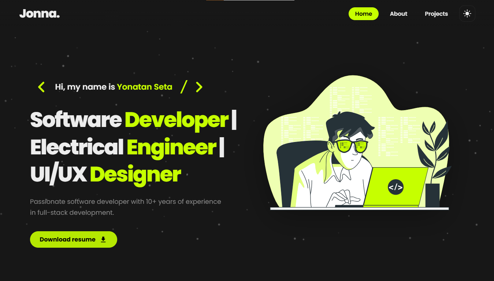
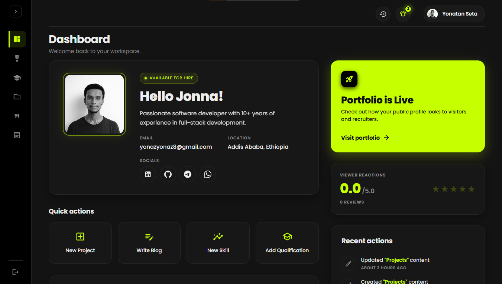
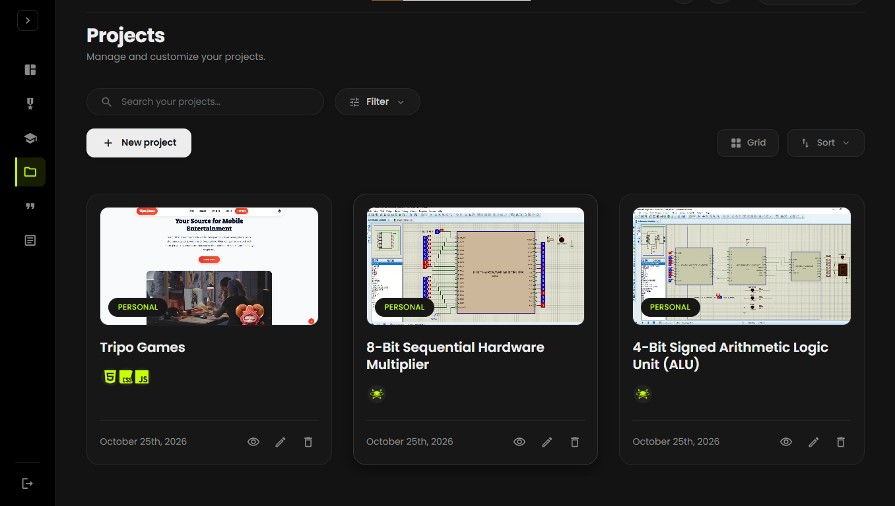

# 🚀 Modern Full-Stack Developer Portfolio & CMS

A high-performance, responsive full-stack developer portfolio and headless Content Management System (CMS) built with **React 19**, **Vite**, **Node.js (Express 5)**, and **MongoDB Atlas**. 

Featuring seamless dark/light mode theming, an interactive project showcase, client recommendations, a built-in tech blog, and a protected administrative dashboard with real-time analytics.

---

<div align="center">

  ### 🌟 Live Interface Preview

  <!-- Placeholder: Hero / Landing View (Light & Dark Mode) -->
  <p align="center">
    
    <br />
    <em>✨ Hero Section showcasing bio, live status, and social profiles</em>
  </p>

</div>

<br />

<div align="center">

| 📊 Admin Analytics Dashboard | 🛠️ Projects & Skills Management |
| :---: | :---: |
| <br /><em>Protected CMS metrics & activity logs</em> | <br /><em>Manage projects, skills, and qualifications</em> |

</div>

---

## 📖 Table of Contents

- [Overview](#-overview)
- [Key Features](#-key-features)
  - [Public Client Experience](#-public-client-experience)
  - [Administrative CMS Suite](#-administrative-cms-suite)
- [System Architecture](#-system-architecture)
- [Tech Stack](#-tech-stack)
- [Project Structure](#-project-structure)
- [Getting Started](#-getting-started)
  - [Prerequisites](#prerequisites)
  - [1. Backend Setup](#1-backend-setup)
  - [2. Database Seeding](#2-database-seeding)
  - [3. Frontend Setup](#3-frontend-setup)
- [Environment Variables](#-environment-variables)
- [API Endpoints](#-api-endpoints)
- [Deployment](#-deployment)
- [License](#-license)

---

## 💡 Overview

This project was engineered to deliver both a lightning-fast visitor showcase and an administrative control panel. Rather than hardcoding portfolio contents, the application is backed by a RESTful API and MongoDB database, allowing every section (profile details, experience timeline, skills matrix, projects, testimonials, and blog articles) to be dynamically updated in real-time through a secured admin portal.

---

## ✨ Key Features

### 🌐 Public Client Experience
- **Dynamic Splash Loading Screen:** Preloads branding assets and animated logo to eliminate UI pop-in or layout shift.
- **Dual-Theme Engine:** Seamless one-click switching between dark mode and light mode with persistent user preference.
- **Interactive Skills Matrix:** Categorized technical and conceptual skills with proficiency indicators and experience metrics.
- **Project Showcase:** Filterable project catalog featuring detailed modals, live demonstration links, technology tags, and source repository shortcuts.
- **Interactive Qualifications Timeline:** Chronological timeline detailing education, professional milestones, and certifications.
- **Testimonials & Endorsements:** Client reviews with ratings and verified links.
- **Developer Tech Blog:** Built-in article publication platform supporting rich previews and categorised posts.
- **Automated Contact Form:** Directly dispatches transactional notifications via the **Resend API**.
- **Cold-Start Awareness:** Server status notification bar informing users when backend services (such as Render free-tier instances) are spinning up.

### 🛡️ Administrative CMS Suite
- **JWT Authentication:** Dual-token security (short-lived access tokens and secure HTTP-only refresh tokens) with bcrypt hashing.
- **Interactive Analytics:** Visualized site activity and profile metrics powered by **MUI X-Charts** and **Chart.js**.
- **Full CRUD Management:**
  - **Profile:** Manage bio, avatars, custom logos, resumes, and social handles.
  - **Skills:** Add, edit, reorder, or delete technical and conceptual proficiencies.
  - **Qualifications:** Maintain career positions, institutions, and dates.
  - **Projects:** Upload project screenshots, define tech stacks, and update links.
  - **Testimonials & Blog:** Review client feedback and publish new blog posts.
- **Media Upload Manager:** Robust multipart upload pipeline powered by **Multer** for images and PDF documents.

---

## 🏗️ System Architecture

```
                    ┌─────────────────────────────────────────┐
                    │               Web Browser               │
                    │        (React 19 + Vite Client)         │
                    └────────────────────┬────────────────────┘
                                         │
                         REST API (JSON) │ Multipart (Files)
                                         ▼
                    ┌─────────────────────────────────────────┐
                    │            Express 5 Server             │
                    │  - Helmet & CORS Security               │
                    │  - Passport + JWT Authentication        │
                    │  - Express Rate Limiting                │
                    │  - Multer File Upload Pipeline          │
                    └───────────┬─────────────────┬───────────┘
                                │                 │
               Queries & Models │                 │ Email Triggers
                                ▼                 ▼
             ┌─────────────────────┐   ┌─────────────────────┐
             │    MongoDB Atlas    │   │     Resend API      │
             │   (Cloud Database)  │   │  (Contact Emails)   │
             └─────────────────────┘   └─────────────────────┘
```

---

## 🛠️ Tech Stack

### Frontend (`/client`)
- **Core:** [React 19](https://react.dev/), [Vite](https://vitejs.dev/)
- **Routing:** [React Router v7](https://reactrouter.com/)
- **UI & Styling:** Vanilla CSS (Custom design tokens), [Material UI (MUI v9)](https://mui.com/)
- **Data Visualization:** [MUI X-Charts](https://mui.com/x/react-charts/), [Chart.js](https://www.chartjs.org/), `react-chartjs-2`
- **File Uploads:** `react-dropzone`
- **Icons:** `simple-icons`, `@mui/icons-material`
- **HTTP Client:** [Axios](https://axios-http.com/)

### Backend (`/Server`)
- **Core:** [Node.js](https://nodejs.org/) (ES Modules), [Express.js v5](https://expressjs.com/)
- **Database:** [MongoDB](https://www.mongodb.com/) via [Mongoose ODM](https://mongoosejs.com/)
- **Authentication:** [Passport.js](https://www.passportjs.org/), `jsonwebtoken`, `bcrypt`
- **Security:** `helmet`, `cors`, `cookie-parser`, `express-rate-limit`
- **Email Service:** [Resend SDK](https://resend.com/)
- **Validation:** `joi`, `express-validator`, `validator`
- **File Management:** `multer`

---

## 📂 Project Structure

```
My-portfolio/
├── client/                           # React + Vite Frontend
│   ├── public/                       # Static public assets
│   ├── src/
│   │   ├── Admin/                    # Administrative CMS (Pages & Components)
│   │   │   ├── Components/           # Admin Sidebar, Modals, CRUD forms
│   │   │   └── Pages/                # Dashboard, Profile, Skills, Projects, etc.
│   │   ├── Components/               # Global components (Navbar, Contacts, Footer, etc.)
│   │   ├── Contexts/                 # React Context Providers for global state
│   │   ├── Hooks/                    # Custom React hooks (reducers, data fetchers)
│   │   ├── Pages/                    # Public pages (Home, About, Projects, Splash)
│   │   ├── Utils/                    # URL parsers, validators, formatters
│   │   ├── assets/                   # Vector graphics, illustrations & styles
│   │   ├── App.jsx                   # Application router & layout structure
│   │   └── main.jsx                  # React DOM mount point
│   ├── index.html
│   ├── vite.config.js
│   └── package.json
│
├── Server/                           # Express.js REST API Backend
│   ├── src/
│   │   ├── Config/                   # DB connection, Passport strategies, environment config
│   │   ├── Controllers/              # Route handlers & business logic
│   │   ├── Middleware/               # Auth guards, rate limiting, error handling
│   │   ├── Models/                   # Mongoose Schemas (Profile, Projects, Blogs, etc.)
│   │   ├── Routes/                   # Modular Express routers
│   │   ├── Seeders/                  # Database migration & mock-data seeder script
│   │   ├── Utils/                    # Upload helpers, tokens, sanitizers
│   │   └── index.js                  # Server entry point & graceful shutdown
│   ├── uploads/                      # Local uploaded media storage
│   └── package.json
│
└── README.md                         # Project documentation
```

---

## ⚡ Getting Started

### Prerequisites
- **Node.js** (v18.0.0 or higher recommended)
- **npm** or **yarn** / **pnpm**
- **MongoDB** instance (Local MongoDB or free [MongoDB Atlas](https://www.mongodb.com/atlas) cluster)

---

### 1. Backend Setup

1. Open your terminal and navigate to the `Server` directory:
   ```bash
   cd Server
   ```
2. Install dependencies:
   ```bash
   npm install
   ```
3. Create your `.env` configuration file:
   ```bash
   cp .env.example .env
   ```
4. Update the values in `.env` with your MongoDB connection string, JWT secrets, and Resend credentials (see [Environment Variables](#-environment-variables)).
5. Start the backend server in development mode:
   ```bash
   npm run dev
   ```
   *The API will be available at `http://localhost:5000` (or your defined `PORT`).*

---

### 2. Database Seeding

To quickly populate your portfolio with mock data and create an initial administrator account:

```bash
cd Server
npm run seed
```

> **Note:** Customize the admin email and password during seeding by specifying `ADMIN_SEED_EMAIL` and `ADMIN_SEED_PASSWORD` in your environment or passing them in the CLI:
> ```bash
> ADMIN_SEED_EMAIL=admin@example.com ADMIN_SEED_PASSWORD=YourSecurePassword123! npm run seed
> ```

---

### 3. Frontend Setup

1. Open a new terminal tab and navigate to the `client` directory:
   ```bash
   cd client
   ```
2. Install dependencies:
   ```bash
   npm install
   ```
3. Create your `.env` configuration file:
   ```bash
   cp .env.example .env
   ```
4. Define your API base URL:
   ```env
   VITE_API_URL=http://localhost:5000/api
   ```
5. Launch the Vite development server:
   ```bash
   npm run dev
   ```
   *The application will open at `http://localhost:5173`.*

---

## ⚙️ Environment Variables

### Server (`Server/.env`)

| Variable | Description | Example / Default |
| :--- | :--- | :--- |
| `PORT` | Listening port for Express | `5000` |
| `NODE_ENV` | Environment mode (`development` / `production`) | `development` |
| `MONGO_URI` | MongoDB Atlas connection string | `mongodb+srv://<user>:<pwd>@cluster...` |
| `JWT_ACCESS_SECRET` | Secret key for signing access tokens | Strong random string (min 32 chars) |
| `JWT_REFRESH_SECRET` | Secret key for signing refresh tokens | Strong random string (min 32 chars) |
| `MY_GMAIL` | Recipient email for contact form alerts | `your.email@example.com` |
| `RESEND_API_KEY` | API key from Resend for sending emails | `re_xxxxxxxxxxxx` |
| `MY_PORTFOLIO_PASSWORD` | Fallback default password for admin | `YourStrongAdminPassword` |
| `MY_NICKNAME` | Display name for splash & branding | `YourName` |
| `FRONTEND_URL` | Whitelisted client URL for CORS | `http://localhost:5173` |

### Client (`client/.env`)

| Variable | Description | Example / Default |
| :--- | :--- | :--- |
| `VITE_API_URL` | Base REST API URL pointing to the backend | `http://localhost:5000/api` |

---

## 🔌 API Endpoints

| Method | Endpoint | Description | Access |
| :--- | :--- | :--- | :--- |
| `GET` | `/health` | Server status and database health check | Public |
| `POST` | `/api/auth/login` | Authenticate admin and return tokens | Public |
| `POST` | `/api/auth/refresh` | Rotate access token using refresh cookie | Public |
| `GET` | `/api/profile` | Retrieve portfolio owner information | Public |
| `PUT` | `/api/profile` | Update profile information | Admin |
| `GET` | `/api/skills` | List all technical and conceptual skills | Public |
| `POST` | `/api/skills` | Add a new skill entry | Admin |
| `GET` | `/api/projects` | Fetch all showcased projects | Public |
| `POST` | `/api/projects` | Create a new project showcase | Admin |
| `GET` | `/api/qualifications` | Get career and education records | Public |
| `GET` | `/api/testimonials` | Fetch client recommendations | Public |
| `GET` | `/api/blogs` | Retrieve published blog posts | Public |
| `POST` | `/api/notifications/contact` | Submit contact form & trigger email alert | Public |
| `POST` | `/api/upload/image` | Upload images (avatar, projects, blogs) | Admin |
| `POST` | `/api/upload/document` | Upload documents (CV / Resume PDF) | Admin |
| `GET` | `/api/activities` | Retrieve admin dashboard activity logs | Admin |

---

## 🚀 Deployment

### Frontend (Vercel)
The client includes a ready-to-use [`vercel.json`](file:///f:/Jonna/My-portfolio/client/vercel.json) configured for Single Page Application (SPA) URL rewrites:
1. Connect your GitHub repository to [Vercel](https://vercel.com/).
2. Set the **Root Directory** to `client`.
3. Add the environment variable `VITE_API_URL` pointing to your production backend (e.g., `https://your-api.onrender.com/api`).
4. Click **Deploy**.

### Backend (Render)
1. Create a **Web Service** on [Render](https://render.com/).
2. Set the **Root Directory** to `Server`.
3. Set the **Build Command** to `npm install` and **Start Command** to `npm start`.
4. Configure your environment variables in the Render Dashboard (`MONGO_URI`, `JWT_ACCESS_SECRET`, `FRONTEND_URL`, etc.).
5. Render will monitor the `/health` endpoint for zero-downtime health checking.

---

## 📄 License

This project is licensed under the [ISC License](file:///f:/Jonna/My-portfolio/Server/package.json). Feel free to adapt and customize it for your personal portfolio.
